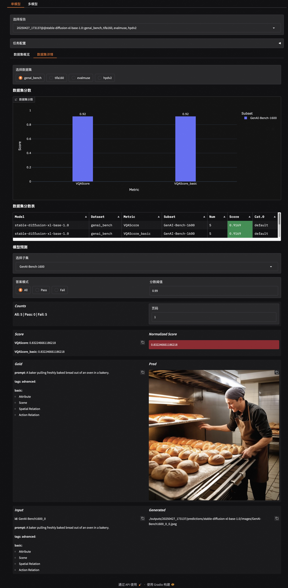

# Text-to-Image Evaluation

The EvalScope framework supports the evaluation of various text-to-image models, including Stable Diffusion, Flux, and more. Users can evaluate these models using the EvalScope framework to obtain performance metrics across different tasks.

## Supported Evaluation Datasets

Please refer to the [documentation](../../get_started/supported_dataset/aigc.md).

## Supported Evaluation Metrics

The EvalScope framework supports a variety of evaluation metrics, allowing users to select suitable metrics based on their requirements. Below is the list of supported evaluation metrics:


| Evaluation Metric | Project Link       | Scoring Range | Remarks                  |
|-------------------|--------------------|---------------|--------------------------|
| `VQAScore`        | [Github](https://github.com/linzhiqiu/t2v_metrics) | [0, 1] (Typically)      | Evaluates text-image consistency using Q&A |
| `CLIPScore`       | [Github](https://github.com/linzhiqiu/t2v_metrics) | [0, 0.3] (Typically) | Uses CLIP to assess image-text matching |
| `BLIPv2Score`     | [Github](https://github.com/linzhiqiu/t2v_metrics) | [0, 1] (Typically)      | Evaluates image-text matching using BLIP's ITM |
| `PickScore`       | [Github](https://github.com/yuvalkirstain/PickScore) | [0, 0.3] (Typically)      | A scoring system based on the CLIP model that predicts user preference for generated images |
| `HPSv2Score`/`HPSv2.1Score` | [Github](https://github.com/tgxs002/HPSv2) | [0, 0.3] (Typically)      | Evaluation metrics based on human preferences, trained on the Human Preference Dataset (HPD v2) |
| `ImageRewardScore` | [Github](https://github.com/THUDM/ImageReward) | [-3, 1] (Typically)      | A reward model trained through human feedback, reflecting human preference for images |
| `MPS`             | [Github](https://github.com/Kwai-Kolors/MPS) | [0, 15] (Typically)      | Kuaishou: A multi-dimensional preference scoring method that comprehensively considers multiple attributes (e.g., realism, semantic alignment) of generated images to assess their quality |
| `FGA_BLIP2Score`  | [Github](https://github.com/DYEvaLab/EvalMuse) | Overall [0, 5] (Typically, each dimension is [0, 1]) | ByteDance: Used for evaluating the quality and semantic alignment of finely generated images |
| `ssim`            | Built-in | [-1, 1] (Higher is better) | Full-reference structural similarity. Requires a reference image |
| `psnr`            | Built-in | [0, 100] (Higher is better) | Full-reference peak signal-to-noise ratio. Identical images are capped at 100. Requires a reference image |
| `lpips`           | [Github](https://github.com/richzhang/PerceptualSimilarity) | [0, +∞) (Lower is better) | Learned perceptual similarity. Requires a reference image and `evalscope[aigc]` |
| `CVTGWordAccuracy` / `CVTGNED` | [TextCrafter](https://github.com/NJU-PCALab/TextCrafter) | [0, 1] (Higher is better) | CVTG-2K text rendering: word membership accuracy and normalized edit similarity, weighted by ground-truth word count |
| `LongTextScore` | [X-Omni](https://github.com/X-Omni-Team/X-Omni) | [0, 1] (Higher is better) | LongText-Bench: matched English words or Chinese characters divided by the ground-truth token count |

### Choosing and Interpreting Metrics

These metric groups answer different questions, so their scores are not directly comparable:

| Evaluation Goal | Candidate Metrics | How to Interpret Them | Common Pitfall |
|-----------------|-------------------|-----------------------|----------------|
| Check semantic alignment between a prompt and an image | `VQAScore`, `CLIPScore`, `BLIPv2Score` | Focus on whether subjects, attributes, or relations match the prompt | A high score does not guarantee better composition, sharpness, or aesthetics |
| Estimate human preference | `PickScore`, `HPSv2Score`/`HPSv2.1Score`, `ImageRewardScore`, `MPS` | Reflect a preference model's combined judgment of overall quality and prompt alignment | The typical ranges above are empirical, not percentages, and cannot be converted across metrics |
| Locate fine-grained errors | `FGA_BLIP2Score` | Inspect object, attribute, color, spatial-relation, and other dimension scores in addition to the overall score | The overall score can hide a clear weakness in one dimension |
| Compare against a reference image | `ssim`, `psnr`, `lpips` | Require a reference image; higher `ssim` and `psnr` or lower `lpips` indicate greater similarity | High reference similarity does not imply high prompt alignment or human preference |

Choose metrics based on the evaluation question: use semantic-alignment metrics for prompt fidelity, preference metrics for overall visual appeal, and full-reference metrics only when a target image exists. To assess both prompt fidelity and visual appeal, combine metrics from different groups. When comparing models, keep the dataset, prompts, metric and model versions, and generation settings consistent.


## Install Dependencies

Users can install the necessary dependencies using the following command:

```bash
pip install evalscope[aigc] -U
```

## Text Rendering Benchmarks

[CVTG-2K](../../benchmarks/cvtg_2k.md) and [LongText-Bench](../../benchmarks/longtext_bench.md)
measure whether a generated image renders the requested text. They load from the public ModelScope
mirrors [evalscope/CVTG-2K](https://modelscope.cn/datasets/evalscope/CVTG-2K) and
[evalscope/LongText-Bench](https://modelscope.cn/datasets/evalscope/LongText-Bench) by default.
CVTG and CVTG-Style contain 1,002 and 998 prompts; LongText-Bench contains 160 prompts per language.

Install the CVTG-2K scorer on Python 3.11 or 3.12 with a supported PaddlePaddle wheel:

```bash
pip install 'evalscope[cvtg_2k]'
```

For local image generation, install `evalscope[aigc,cvtg_2k]`.

LongText-Bench transcribes images through a vision API and does not require local VLM weights or
an accelerator. Its default is `qwen3.8-flash` on DashScope with thinking disabled. Set
`DASHSCOPE_API_KEY`; the default scorer then works without extra `dataset_args`. To override it:

```python
dataset_args = {
    'longtext_bench': {
        'metric_list': [{'LongTextScore': {
            'model': 'qwen3.8-flash',
            'generation_config': {'extra_body': {'enable_thinking': False}},
        }}],
    },
}
```

Pass this `dataset_args` to `TaskConfig`. For another OpenAI-compatible vision service, set the scorer's
`api_url` and `api_key` explicitly. These settings belong to the transcription service; the top-level
`api_url` and `api_key` still configure the image generation service. API transport failures and
token-limit truncation exclude the sample from this metric.

The scorer transcribes the image; deterministic rules calculate the text matching score. The official
transcription model is Qwen2.5-VL-7B. Using `qwen3.8-flash` or another model can change the score, so
record the transcription model alongside your results and do not directly compare them with the
official Qwen2.5-VL-7B results. No transformers or VLM inference dependencies are needed for this scorer.

For an OpenAI-compatible image generation service:

```python
from evalscope import TaskConfig, run_task

run_task(TaskConfig(
    model='YOUR_IMAGE_MODEL',
    model_task='image_generation',
    eval_type='text2image',
    api_url='http://localhost:8895/v1',
    api_key='EMPTY',
    datasets=['cvtg_2k', 'longtext_bench'],
    dataset_hub='modelscope',
    limit=1,  # Per subset; remove for a full evaluation.
))
```

CVTG scores combine all ground-truth words across both subsets. LongText-Bench aggregates words
within English and characters within Chinese, then averages the two language scores for its overall
result. When both languages are requested and one has no usable scores, the report shows the available
language scores without an overall score. Use `repeats=4` for the official LongText sampling protocol.
Scoring failures are excluded from the affected metric. Check the metric's sample count and the
run's execution summary. Successful recognition with no text counts as missing text.
Use `rerun_review=True` to rescore cached images with the current scoring version.

## OpenAI-Compatible Image Service

EvalScope supports self-hosted services that implement the OpenAI Images API contract. Set `eval_type` to
`text2image` and pass the API base URL. Omitting `eval_type` selects `text2image` automatically for an image
generation task, and `eval_type='openai_api'` is corrected to it with a warning, because the Chat Completions
API cannot generate images:

```python
from evalscope import TaskConfig, run_task
from evalscope.constants import EvalType, ModelTask

task_cfg = TaskConfig(
    model='YOUR_MODEL_ID',
    model_task=ModelTask.IMAGE_GENERATION,
    eval_type=EvalType.TEXT2IMAGE,
    api_url='http://localhost:8895/v1',
    api_key='EMPTY',
    datasets=['tifa160'],
    limit=5,
    generation_config={
        'height': 1024,
        'width': 1024,
        'timeout': 120,
        'retries': 3,
        'retry_interval': 1,
    },
)

run_task(task_cfg=task_cfg)
```

The service must accept `POST /v1/images/generations` with the OpenAI request fields `model`, `prompt`,
optional `n`, and optional `size`. Its JSON response must contain a non-empty `data` list. EvalScope evaluates
the first item, which must have either `b64_json` or an HTTP(S) `url`. Base64 data may be plain or use a data
URI. You may pass a base URL, a full `/images/generations` URL, or a copied `/chat/completions` URL; EvalScope
normalizes these forms before calling the Images API.

The returned bytes must decode as an image; an HTML page or other non-image payload fails the sample with an error
instead of surfacing later at metric time. `generation_config.retries` is the total number of attempts for
transient failures such as 429 and 5xx responses; client errors such as 400, 401, 403, 404, and 422 are raised
after the first attempt. Without an explicit `generation_config`, service mode only sends the default `size`
(`1024x1024`). Set `num_inference_steps` or `guidance_scale` explicitly to forward them in the request body; this
works only with services that accept these non-OpenAI fields.

`api_key='EMPTY'` first checks `EVALSCOPE_API_KEY`, then `OPENAI_API_KEY`. If neither variable is set, `EMPTY`
is sent as a placeholder for a local service. Requests are sent one at a time unless you raise
`eval_batch_size`, which sets the number of concurrent requests. This mode does not cover native provider
protocols such as the DashScope/Model Studio image-generation API, responses with an `images` field,
asynchronous submit-and-poll APIs, or image editing. Those protocols need separate adapters.

## Local Model Evaluation

Users can configure text-to-image model evaluation tasks using the command below.

Here is an example code demonstrating the evaluation of the modelscope's Stable Diffusion XL model on `tifa160` with default metrics:

```python
from evalscope import TaskConfig, run_task
from evalscope.constants import EvalType, ModelTask

task_cfg = TaskConfig(
    model='stabilityai/stable-diffusion-xl-base-1.0',  # model id on modelscope
    model_task=ModelTask.IMAGE_GENERATION,  # must be IMAGE_GENERATION
    eval_type=EvalType.TEXT2IMAGE,
    model_args={
        'pipeline_cls': 'DiffusionPipeline',
        'use_safetensors': True,
        'variant': 'fp16',
        'torch_dtype': 'torch.float16',
    },
    datasets=[
        'tifa160',
        'genai_bench',
        'evalmuse',
        'hpdv2',
    ],
    limit=5,
    generation_config={
        'height': 1024,
        'width': 1024,
        'num_inference_steps': 50,
        'guidance_scale': 9.0,
    }
)

# Run the evaluation task
run_task(task_cfg=task_cfg)
```
### Parameter Description
For basic parameters, please refer to: [Parameter Description](../../get_started/parameters.md).

Important parameters to note:
- `model`: Model ID, supports local models and modelscope model id.
- `model_task`: Model task type, must be `image_generation`.
- `model_args`: Model loading parameters, supports passing in model loading parameters including:
    - `pipeline_cls`: `Pipeline` class from `diffusers` used to load the model, default is `DiffusionPipeline`. The remaining parameters are parameters of this `Pipeline`. Please refer to [diffusers documentation](https://huggingface.co/docs/diffusers/using-diffusers/loading).
    - `use_safetensors`: Whether to use safe tensors.
    - `variant`: Model variant.
- `generation_config`: Generation parameters, supports passing in model generation parameters. Refer to the corresponding `Pipeline` class for parameters generally including:
    - `height`: Height of the generated image.
    - `width`: Width of the generated image.
    - `num_inference_steps`: Inference steps for generating images.
    - `guidance_scale`: Guidance scale for generating images.

### Output Results

Upon completion of the evaluation, EvalScope will output the evaluation results, including model ID, dataset, metric, subset, quantity, and score. Below is an example of the output result:


```text
+------------------------------+-------------+------------------------------+------------------+-------+---------+---------+
| Model                        | Dataset     | Metric                       | Subset           |   Num |   Score | Cat.0   |
+==============================+=============+==============================+==================+=======+=========+=========+
| stable-diffusion-xl-base-1.0 | evalmuse    | FGA_BLIP2Score:overall_score | EvalMuse         |     5 |  3.3148 | default |
+------------------------------+-------------+------------------------------+------------------+-------+---------+---------+
| stable-diffusion-xl-base-1.0 | evalmuse    | FGA_BLIP2Score:activity      | EvalMuse         |     2 |  0.4592 | default |
+------------------------------+-------------+------------------------------+------------------+-------+---------+---------+
| stable-diffusion-xl-base-1.0 | evalmuse    | FGA_BLIP2Score:attribute     | EvalMuse         |    11 |  0.8411 | default |
+------------------------------+-------------+------------------------------+------------------+-------+---------+---------+
| stable-diffusion-xl-base-1.0 | evalmuse    | FGA_BLIP2Score:location      | EvalMuse         |     2 |  0.8763 | default |
+------------------------------+-------------+------------------------------+------------------+-------+---------+---------+
| stable-diffusion-xl-base-1.0 | evalmuse    | FGA_BLIP2Score:object        | EvalMuse         |    14 |  0.705  | default |
+------------------------------+-------------+------------------------------+------------------+-------+---------+---------+
| stable-diffusion-xl-base-1.0 | evalmuse    | FGA_BLIP2Score:material      | EvalMuse         |     4 |  0.7717 | default |
+------------------------------+-------------+------------------------------+------------------+-------+---------+---------+
| stable-diffusion-xl-base-1.0 | evalmuse    | FGA_BLIP2Score:food          | EvalMuse         |     1 |  0.611  | default |
+------------------------------+-------------+------------------------------+------------------+-------+---------+---------+
| stable-diffusion-xl-base-1.0 | evalmuse    | FGA_BLIP2Score:color         | EvalMuse         |     1 |  0.784  | default |
+------------------------------+-------------+------------------------------+------------------+-------+---------+---------+
| stable-diffusion-xl-base-1.0 | evalmuse    | FGA_BLIP2Score:human         | EvalMuse         |     2 |  0.2692 | default |
+------------------------------+-------------+------------------------------+------------------+-------+---------+---------+
| stable-diffusion-xl-base-1.0 | evalmuse    | FGA_BLIP2Score:spatial       | EvalMuse         |     1 |  0.1345 | default |
+------------------------------+-------------+------------------------------+------------------+-------+---------+---------+
| stable-diffusion-xl-base-1.0 | genai_bench | VQAScore                     | GenAI-Bench-1600 |     5 |  0.9169 | default |
+------------------------------+-------------+------------------------------+------------------+-------+---------+---------+
| stable-diffusion-xl-base-1.0 | genai_bench | VQAScore_basic               | GenAI-Bench-1600 |     5 |  0.9169 | default |
+------------------------------+-------------+------------------------------+------------------+-------+---------+---------+
| stable-diffusion-xl-base-1.0 | hpdv2       | HPSv2.1Score                 | HPDv2            |     5 |  0.3268 | default |
+------------------------------+-------------+------------------------------+------------------+-------+---------+---------+
| stable-diffusion-xl-base-1.0 | hpdv2       | HPSv2.1Score_Animation       | HPDv2            |     5 |  0.3268 | default |
+------------------------------+-------------+------------------------------+------------------+-------+---------+---------+
| stable-diffusion-xl-base-1.0 | tifa160     | PickScore                    | TIFA-160         |     5 |  0.2261 | default |
+------------------------------+-------------+------------------------------+------------------+-------+---------+---------+ 
```

## Custom Evaluation

Users can configure custom prompts to evaluate tasks using the command below.


### Custom Dataset Evaluation

Provide a JSONL file in the following format:

```json
{"id": 1, "prompt": "A beautiful sunset over the mountains", "image_path": "/path/to/generated/image1.jpg"}
{"id": 2, "prompt": "A futuristic city skyline", "image_path": "/path/to/generated/image2.jpg"}
```

- `id`: Unique identifier for the evaluation data.
- `prompt`: Prompt text for generating the image.
- `image_path`: Path to the generated image.

Full-reference image metrics (`ssim`, `psnr`, `lpips`) compare `image_path` against a reference image.
To use them, add a reference image field to each JSONL record:

```json
{"id": 1, "prompt": "A red rose", "image_path": "/path/to/pred.jpg", "reference_image_path": "/path/to/ref.jpg"}
```

Supported reference field names: `reference_image_path`, `target_image_path`, `ref_image_path`, `gt_image_path`,
`ground_truth_image_path`, or the corresponding non-`_path` variants (e.g., `reference_image`) for in-memory objects.
Images are converted to RGB and normalized to [0, 1], so the default `data_range=1.0` should be kept unless you
intentionally override the normalized range.

#### Configure Evaluation Task

The development process for current text-to-image models is becoming increasingly intricate. Some developers need to rely on visual workflow tools like ComfyUI for multi-module composition or utilize API interfaces to access cloud-based model services, such as Stable Diffusion WebUI or commercial API platforms. In these scenarios, EvalScope offers a "model-free" evaluation mode. This mode allows users to initiate the evaluation process by simply providing a list of prompt texts and the corresponding image storage paths, without the need to download model weights locally or perform inference computations.

Users can configure custom prompts for evaluation tasks using the following command.

```{note}
- For custom evaluation tasks, you do not need to provide the `model` parameter, `model_id` is used to specify the model name. Simply configure the `image_path` of the corresponding model generation.
- All metrics models are loaded upon task initialization, which may result in large memory usage. It is recommended to adjust the metrics or divide the calculations into multiple tasks as needed.
```

Run the following code:

```python
from evalscope import TaskConfig, run_task
from evalscope.constants import ModelTask, EvalType

task_cfg = TaskConfig(
    model_id='T2I-Model',
    model_task=ModelTask.IMAGE_GENERATION,  # must be IMAGE_GENERATION
    eval_type=EvalType.TEXT2IMAGE,
    datasets=[
        'general_t2i'
    ],
    dataset_args={
        'general_t2i': {
            'metric_list': [
                'PickScore',
                'CLIPScore',
                'HPSv2Score',
                'BLIPv2Score',
                'ImageRewardScore',
                'VQAScore',
                'FGA_BLIP2Score',
                'MPS',
                # Full-reference metrics (require reference_image_path in JSONL):
                # 'ssim',
                # 'psnr',
                # 'lpips',  # requires evalscope[aigc]
                ],
            'dataset_id': 'custom_eval/multimodal/t2i/example.jsonl',
        }
    }
)

run_task(task_cfg=task_cfg)
```

#### Output Results

Output results are as follows:

```text
+-------------+-------------+------------------+----------+-------+---------+---------+
| Model       | Dataset     | Metric           | Subset   |   Num |   Score | Cat.0   |
+=============+=============+==================+==========+=======+=========+=========+
| dummy-model | general_t2i | PickScore        | example  |    10 |  0.2071 | default |
+-------------+-------------+------------------+----------+-------+---------+---------+
| dummy-model | general_t2i | CLIPScore        | example  |    10 |  0.1996 | default |
+-------------+-------------+------------------+----------+-------+---------+---------+
| dummy-model | general_t2i | HPSv2Score       | example  |    10 |  0.2626 | default |
+-------------+-------------+------------------+----------+-------+---------+---------+
| dummy-model | general_t2i | HPSv2.1Score     | example  |    10 |  0.238  | default |
+-------------+-------------+------------------+----------+-------+---------+---------+
| dummy-model | general_t2i | BLIPv2Score      | example  |    10 |  0.2374 | default |
+-------------+-------------+------------------+----------+-------+---------+---------+
| dummy-model | general_t2i | ImageRewardScore | example  |    10 | -0.238  | default |
+-------------+-------------+------------------+----------+-------+---------+---------+
| dummy-model | general_t2i | VQAScore         | example  |    10 |  0.6072 | default |
+-------------+-------------+------------------+----------+-------+---------+---------+
| dummy-model | general_t2i | FGA_BLIP2Score   | example  |    10 |  2.6918 | default |
+-------------+-------------+------------------+----------+-------+---------+---------+
| dummy-model | general_t2i | MPS              | example  |    10 |  4.8749 | default |
+-------------+-------------+------------------+----------+-------+---------+---------+ 
```

### Custom Benchmark Evaluation

To use a custom model for benchmark evaluation, download the corresponding benchmark JSONL file from modelscope, e.g., `eval_muse_format.jsonl`, and replace the model-generated image paths with the corresponding `image_path`, as shown below:

```json
{"id":"EvalMuse_1","prompt":"cartoon die cut sticker of hotdog with white border on gray background","tags":["cartoon (attribute)","die cut sticker (object)","hotdog (food)","white (object)","border (object)","gray (color)","background (attribute)"], "image_path":"/path/to/generated/image1.jpg"}
{"id":"EvalMuse_2","prompt":"Fiat 124","tags":["Fiat 124 (object)"], "image_path":"/path/to/generated/image2.jpg"}
```

#### Configure Evaluation Task

Configure the corresponding evaluation task, and run the following code:

```python
from evalscope import TaskConfig, run_task
from evalscope.constants import ModelTask, EvalType

task_cfg = TaskConfig(
    model_id='T2I-Model',
    model_task=ModelTask.IMAGE_GENERATION,  # must be IMAGE_GENERATION
    eval_type=EvalType.TEXT2IMAGE,
    datasets=[
        'evalmuse',
    ],
    dataset_args={
        'evalmuse': {
            'dataset_id': 'custom_eval/multimodal/t2i/example.jsonl',
        }
    }
)

run_task(task_cfg=task_cfg)
```

## Visualization

The EvalScope framework supports visualization of evaluation results. Users can generate a visual report using the following command:

```bash
evalscope service
```

For usage documentation, please refer to the [visualization documentation](../../get_started/visualization.md).

An example is shown below:


