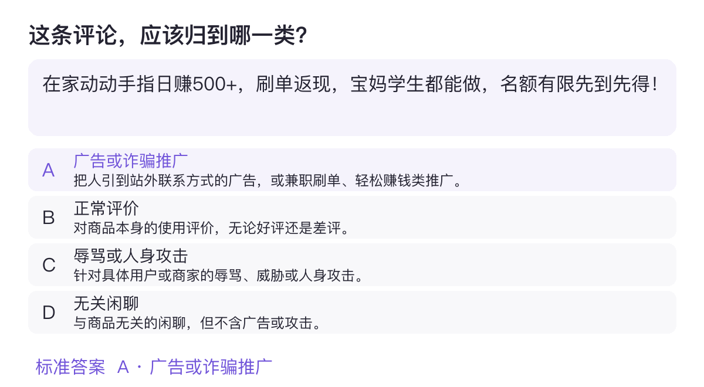
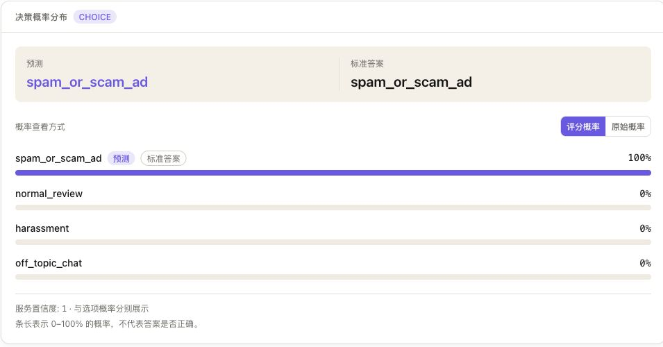
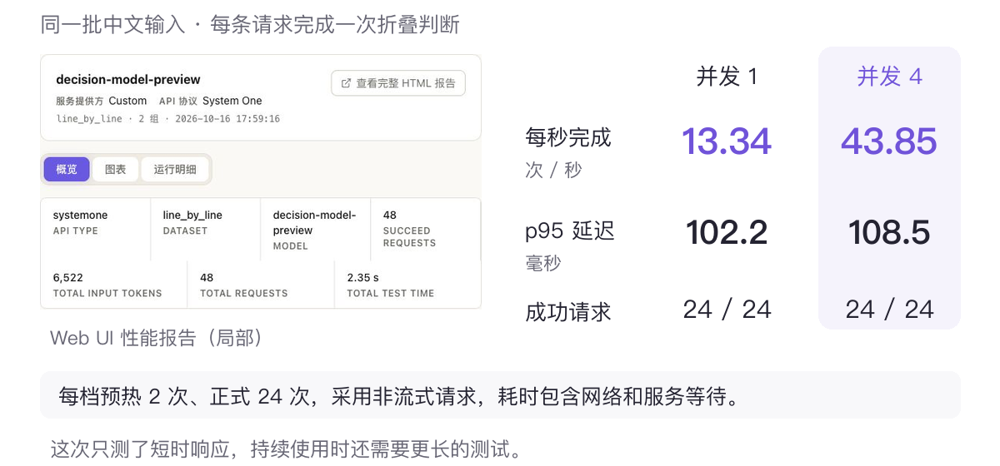
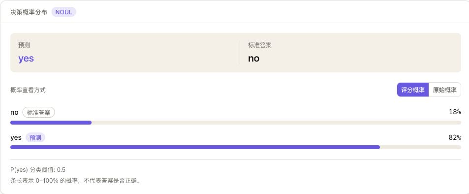

# 让 AI 做判断：用 EvalScope 上手决策模型

打开一个商品的评论区，首屏往往不是真实用户的声音：「在家动动手指日赚500」「同款找我买有内部价」「点赞返现」。不管你只是刷评论的人，还是要做一款把评论展示给别人看的产品，想要的都是同一件事——尽快分清哪些值得读、哪些该折叠。

把这件事丢给普通大模型，它很可能先写三段分析，再委婉地给出结论。可你想要的只有两样：一个答案，以及它对答案的把握有几成。

这就是决策模型的地盘。它不写文章，只表态：返回一个类别、一个分数，或一句「是 / 否」，再附上每个选项的概率。[Jev](https://typesafe.ai/blog/introducing-system-one-models-and-jev)、[Clef-Flash](https://developers.cloudflare.com/changelog/post/2026-10-01-clef-workers-ai/) 就是这类模型。需要解释和展开讨论的内容，再交给 Chat 模型不迟。

本文用 **EvalScope** 把决策模型接进来，一路检查三件事：题答得对不对、概率能不能用、响应够不够快。先用一套公开题跑通流程，扩展部分再讲测自己的数据和自部署。

## 1. 决策模型能答哪三种题

筛选评论只是决策模型的一种用法。消息分类、内容评分、判断两段文字是否相关，也都可以交给它。常见的题型有三种。

先看一道真实的中文评论分类题，留言节选如下。

> 在家动动手指日赚500+，刷单返现，宝妈学生都能做，名额有限先到先得！

题目包含四个选项，模型返回各选项的概率；标准答案留给 EvalScope 核对，不会发给模型。下图是这道题的原样（节选自 [OpenDecisions](https://modelscope.cn/datasets/evalscope/OpenDecisions) 公开原题）：



从广告推广、正常评价、辱骂和闲聊里选一个——这种「多选一」叫 **Choice**，模型返回每个选项的概率，适合消息分类、请求分流。

另外两种同样常用：**Noul** 是是非判断，只问某个条件成不成立，返回「成立」的概率，比如「这条评论是否该折叠」；**Score** 是分级评分，在几个有高低顺序的等级里打分，适合完成度、干扰程度这类有轻重之分的判断。

出题的关键，是把判断对象、规则和可选答案说清楚：分类型用 Choice，判断条件是否成立用 Noul，按程度打分用 Score。规则要具体——「讨论商品价格可以保留，商家招揽客户应折叠」，比一句「过滤不好的内容」清楚得多。

## 2. 一条命令，跑通公开题评测

这次实测使用 `decision-model-preview`，通过百炼 System One 接口（决策模型通用的请求格式）传入题目、接收判断和概率。兼容这个接口的其他服务也能用同样的命令，模型名、API 地址和 Key 换成自己的即可。

依次执行下面的命令。公开题用 [OpenDecisions](https://modelscope.cn/datasets/evalscope/OpenDecisions)，两千多道题、三种题型都覆盖，EvalScope 会自己取数、出题、评分：

```bash
# 安装依赖（含压测和 Web UI 组件）
pip install 'evalscope[perf,service]'

# 连接参数：换成所用服务的模型名、地址和 Key
export DECISION_MODEL='decision-model-preview'
export DECISION_API_URL='https://trial.cn-beijing.maas.aliyuncs.com/compatible-mode/v1'
export DECISION_API_KEY='替换为所用服务的 API Key'

# 跑公开题评测
evalscope eval \
  --model "$DECISION_MODEL" \
  --eval-type systemone_api \
  --api-url "$DECISION_API_URL" \
  --api-key "$DECISION_API_KEY" \
  --datasets open_decisions
```

运行结束后，终端会打印评测汇总表。下面节选本文 59 道内容审核题的实测结果；上面的命令默认评测全量 2352 道题。

| Model | Dataset | Metric | Subset | Num | Score |
| --- | --- | --- | --- | ---: | ---: |
| decision-model-preview | OpenDecisions | Intelligence ↑ | default | 59 | 39.1% |
| decision-model-preview | OpenDecisions | Calibration ↑ | default | 59 | 53.9% |
| decision-model-preview | OpenDecisions | Capability ↑ | default | 59 | 46.5% |

Capability 是默认的综合指标，结合判断表现（Intelligence）和概率可靠性（Calibration），三项都是越高越好。

想先快速跑通，可以加 `--limit 50` 只取前 50 道。

## 3. 在 Web UI 里读懂结果

评测完成后启动 Web UI，在 `http://127.0.0.1:9000` 的「评估」页面打开模型报告：

```bash
evalscope service
```

在「预测浏览」中打开一道题，可以对照模型预测和标准答案，还能查看每个选项的概率。下面就是前面那道中文评论题的真实结果，模型选中了广告推广，界面同时标出了对应的标准答案。



图中的 `spam_or_scam_ad` 对应广告推广，其余三项分别是正常评价、辱骂和闲聊。除了看有没有选对，这组概率也能帮助你观察模型是否在几个选项之间犹豫。需要检查错误时，可以筛出错题，对照题目和概率一起看。

## 4. 响应速度同样重要

自动分类和筛选要反复调用模型，等待时间同样影响体验。压测也不用自己整理数据——还是刚才那套公开题，数据集填 `open_decisions` 就会自动加载题目、逐条发给模型：

```bash
evalscope perf --api systemone --model "$DECISION_MODEL" \
  --url "$DECISION_API_URL" --api-key "$DECISION_API_KEY" \
  --dataset open_decisions \
  --parallel 1 4 --number 24 24 --warmup-num 2 --no-stream \
  --outputs-dir ./perf-results
```

下图是我们用中文评论请求做的一次短时测试，并发从 1 提到 4，吞吐翻了三倍多，p95 延迟只略微上涨。左侧是实际报告，右侧是两档并发的对比；p95 表示 95% 请求的延迟水平。上面的命令则可以直接用公开题测试同一流程。



完整记录可在 Web UI 的「性能」页选择 perf-results 查看。接入自己的应用前，记得加大请求量看持续表现；换模型时沿用相同题目和测试方式，比较也更方便。

## 5. 扩展：换成你自己的数据

公开题给的是一个公共参照，合不合你的用途，还得看你自己的数据。把要判断的内容整理成[自定义数据格式](../advanced_guides/custom_dataset/decision.md)，存到本地，再用 `general_decision` 指过去跑一遍即可：

```bash
evalscope eval \
  --model "$DECISION_MODEL" \
  --eval-type systemone_api \
  --api-url "$DECISION_API_URL" \
  --api-key "$DECISION_API_KEY" \
  --datasets general_decision \
  --dataset-args '{"general_decision":{"local_path":"./decision-data"}}'
```

自己的数据里，错题尤其值得打开看。比如下面这条提醒，按规则应该保留，模型却给了 82% 的折叠概率，预测与标准答案刚好相反。

> 有人在评论里留了商家电话，我已经举报，这条评论不重复那些联系方式。



高概率也可能判断错。折叠门槛调高，通常能减少误伤，也可能漏掉更多推广，具体取舍要放回自己的数据里看。如果错误集中在某一类内容，可以补充这类样本、调整规则，或用 ms-swift [训练自己的决策模型](https://swift.readthedocs.io/en/latest/BestPractices/Decision.html)，再用同一套题检查变化。更多概率指标见[决策模型评测说明](../user_guides/systemone.md)。

## 6. 扩展：在自己机器上部署

不想用托管服务，也可以在自机上跑开源的 [Cloudflare/clef-flash](https://modelscope.cn/models/Cloudflare/clef-flash)（约 9B、基于 Qwen3.5-9B，支持三类题型）。需要一个带 System One 决策头支持的 vLLM；装好后起服务、换连接参数、跑评测，命令都在下面这一个块里：

```bash
pip install -U modelscope
pip install -U --pre vllm --extra-index-url https://wheels.vllm.ai/nightly
VLLM_USE_MODELSCOPE=true vllm serve Cloudflare/clef-flash \
  --served-model-name clef-flash \
  --max-model-len 16384 --port 8000

# 服务起来后，另开一个终端，换连接参数并评测
export DECISION_MODEL='clef-flash'
export DECISION_API_URL='http://127.0.0.1:8000/v1'
export DECISION_API_KEY='EMPTY'
evalscope eval --model "$DECISION_MODEL" --eval-type systemone_api --api-url "$DECISION_API_URL" --api-key "$DECISION_API_KEY" --datasets open_decisions
```

## 总结

评论筛选只是决策模型的一种用法。消息该分到哪类、两段内容是否相关、哪个回答更符合要求，都能写成类似的问题；EvalScope 的[数据集列表](../get_started/supported_dataset/llm.md)里有对应入口，连接其他 System One 服务见[决策模型 API 配置](../user_guides/systemone.md)。

决策模型适合答案范围明确的任务：分类、是非判断、评分。它把判断和概率直接交给应用，怎么用由你的规则决定。合不合适，取决于三件事：规则写没写清楚、错误能不能接受、调用速度够不够。

题目、结果和命令都值得留下：下次换模型、改规则，重跑一遍就能对比。从你日常遇到的一条分类、筛选或评分需求开始，写下一组自己认可的答案，看看模型在哪里和你判断不同——比起只看公开榜单，这份贴近自己用途的报告，更容易回答「这个模型用起来合不合适」。
