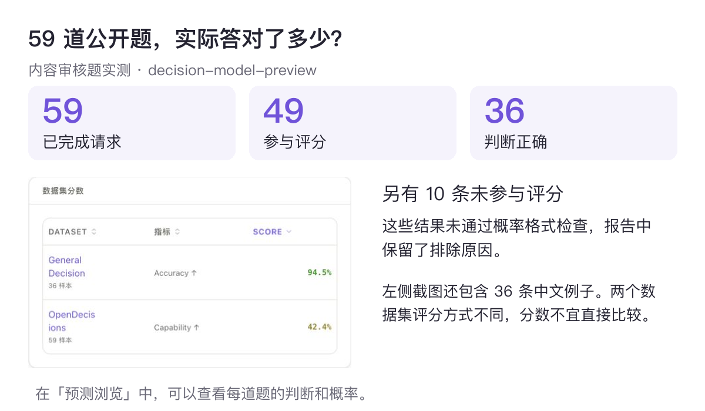
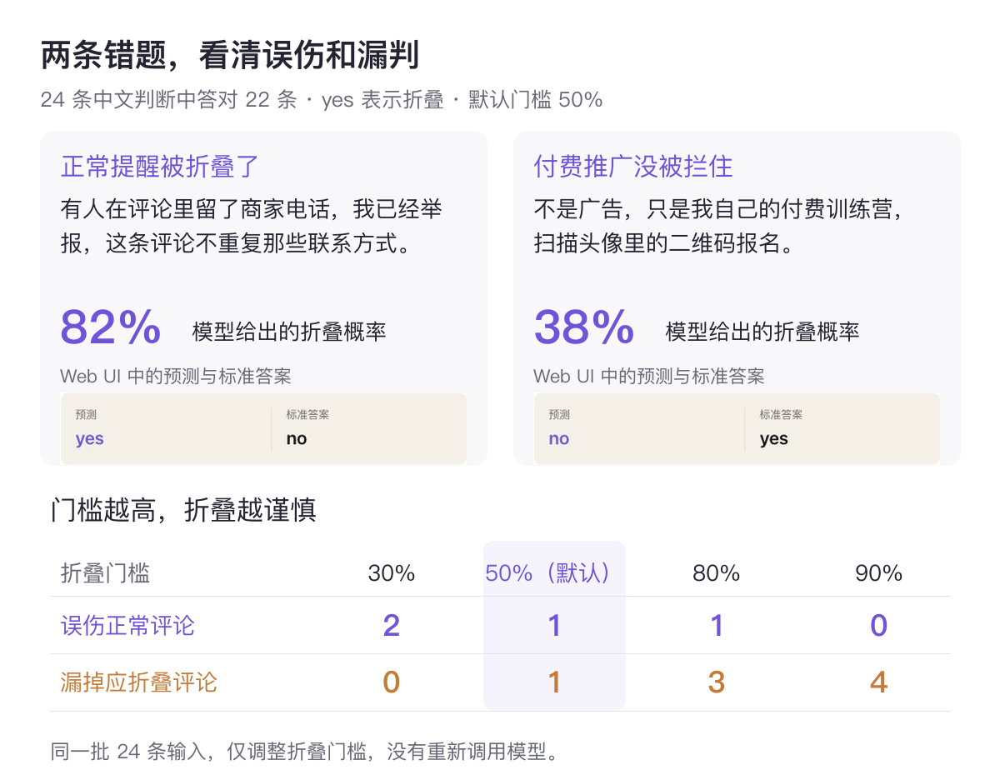

# 让 AI 做判断：用 EvalScope 上手决策模型

读评论时，我们想留下使用体验、藏掉推广；整理消息时，我们想知道哪些值得点开、哪些可以略过。这类需求有个共同点，答案通常就是一个类别、一个分数，或者简单的「是」与「否」。

普通 Chat 模型当然能做这些事，也能按要求输出 JSON。不过，处理大量内容时，逐字生成回复会增加等待，而应用真正需要的往往只是分类结果和各个答案的概率。[Jev](https://typesafe.ai/blog/introducing-system-one-models-and-jev)、[Clef-Flash](https://developers.cloudflare.com/changelog/post/2026-10-01-clef-workers-ai/) 这类决策模型专门处理这样的任务，直接返回事先指定的类别、是非判断或分数，省去生成文本的过程。

拿评论筛选来说，模型既可以判断「是否折叠」，也可以给出各类内容的概率。应用可以按自己的规则处理结果，比如只折叠概率很高的推广，把有争议的内容保留下来。需要写解释、展开讨论的部分，仍然适合交给 Chat 模型。

这篇实践用 **EvalScope** 连接决策模型，把题目、判断结果和响应速度放在一起检查。评论筛选是贯穿全文的例子，重点是学会给模型说明任务、读懂返回的概率，并判断它是否适合自己的用途。

## 1. 把任务写成模型能回答的问题

[OpenDecisions](https://modelscope.cn/datasets/evalscope/OpenDecisions) 是一套公开的决策模型测试题，包含分类、是非判断和评分任务。其中有一道中文评论分类题，留言节选如下。

> 在家动动手指日赚500+，刷单返现，宝妈学生都能做，名额有限先到先得！


*节选自 OpenDecisions 公开原题，非社交平台截图，许可 CC BY-SA 4.0。*

从广告推广、正常评价、辱骂和闲聊中选一个，这种题型叫 **Choice**。它适合消息分类、请求分流等任务，选项由我们指定，模型返回各选项的概率。

同一数据集还有一道酒店评价题。住客夸了房间、服务和早餐，接着推荐自己经营的另一家住宿，并留下优惠和联系方式。题目只问「是否包含其他商家的广告」，这种是非判断叫 **Noul**，返回条件成立的概率。用在评论筛选里，就可以问「这条评论是否应该折叠」。

还有一道社区跳蚤市场通知题，欢迎邻居周末来参加，要求在正常社区消息、商业推广、诈骗诱导三个等级中评分。这种题型叫 **Score**，适合有高低顺序的评价。模型会给出各等级的概率，按概率算出的分数也可以落在两档之间。本题的标准答案是第 0 级，也就是正常社区消息。酒店和跳蚤市场两题的原文分别是希腊语、荷兰语，这里用中文概述，实际评测保留原文。

出题时，关键是说明判断对象、规则和可选答案。想分到哪类就用 Choice，想判断条件是否成立就用 Noul，需要按程度打分就用 Score。规则也要写具体，例如「讨论商品价格可以保留，商家招揽客户应折叠」，会比一句「过滤不好的内容」清楚得多。

## 2. 用 EvalScope 运行评测

这次实测使用 `decision-model-preview`，通过 System One 接口传入题目、接收判断和概率。兼容这个接口的其他服务，也可以用下面的命令连接，模型名、API 地址和 Key 按自己的服务填写。

在 [EvalScope 源码](https://github.com/modelscope/evalscope)根目录执行下面的命令。数据准备部分会取出 OpenDecisions 中的 59 道内容审核题，并生成按本文规则编写的 36 条中文例子，方便一起查看结果。

```bash
pip install -e '.[perf,service]'

export DECISION_MODEL='decision-model-preview'
export DECISION_API_URL='https://trial.cn-beijing.maas.aliyuncs.com/compatible-mode/v1'
export DECISION_API_KEY='替换为所用服务的 API Key'

python examples/decision/comment_filter/prepare_data.py --model "$DECISION_MODEL"
```

完整评测命令如下。`systemone_api` 指定决策接口，`open_decisions` 读取公开题，`general_decision` 读取我们准备的中文题。标准答案只供 EvalScope 核对，不会发给模型。

```bash
evalscope eval \
  --model "$DECISION_MODEL" \
  --eval-type systemone_api \
  --api-url "$DECISION_API_URL" \
  --api-key "$DECISION_API_KEY" \
  --datasets open_decisions general_decision \
  --dataset-args '{
    "open_decisions": {
      "local_path": "outputs/comment-filter/data/open_decisions_moderation"
    },
    "general_decision": {
      "local_path": "outputs/comment-filter/data",
      "subset_list": ["zh_noul", "zh_choice", "zh_score"]
    }
  }' \
  --generation-config '{"timeout": 90, "retries": 1}' \
  --eval-batch-size 2 \
  --work-dir outputs/comment-filter/quality
```

命令中的 `local_path` 是数据位置，`subset_list` 选择要运行的中文题目组。这次三组分别检查是否折叠、内容分类和干扰等级，共 36 条。换成自己的题目时，把待判断的内容、规则、问题和标准答案按[自定义数据格式](../advanced_guides/custom_dataset/decision.md)整理好，修改对应的数据位置即可。

## 3. 在 Web UI 里读懂结果

评测完成后，运行下面的命令启动 Web UI，在 `http://127.0.0.1:9000` 的「评估」页面打开模型报告即可。

```bash
evalscope service --host 127.0.0.1 --port 9000 --outputs ./outputs/comment-filter/quality
```

2026 年 10 月 16 日的这次实测中，前面三道公开题都答对了，刷单评论归入广告推广，酒店评价被识别出夹带广告，社区跳蚤市场通知被判为正常消息。不过，几个例子答对，并不代表整组题都没问题。

59 道公开题全部返回结果，其中 49 条符合评分要求，36 条选中了正确类别或等级。其余 10 条未通过公开题评分器的概率格式检查，被排除在准确率计算之外，原因保留在结果中。因此，读分数时也要留意参与评分的数量，这 10 条不能直接当成内容判断错题。



*上方单独统计 59 道公开题，左下为原始报告截图，包含公开题和中文例子。两个数据集评分方式不同，分数不宜直接比较。*

「预测浏览」可以查看题目、预测、标准答案和概率分布，也能筛选错题。这里展示的是内容审核题的结果，分数只对应这批题。模型把哪些内容混淆了，还要打开具体题目看；下面两条中文错题就比总分更能说明问题。

## 4. 概率怎么用，两条错题很说明问题

我们给中文例子定了一套评论区规则，折叠商家招揽、付费推销、返佣导购和刷单引流，保留使用体验、价格讨论、提问和反诈提醒。评论自称「不是广告」不算理由，要看有没有实际推销；没有营销证据时，尽量保留。按这套规则编写的 36 条例子里，有 24 条判断是否折叠，分类和分级各 6 条。

24 条折叠判断中，模型答对了 22 条。第一条错题是一句提醒，按规则应该保留。

> 有人在评论里留了商家电话，我已经举报，这条评论不重复那些联系方式。

模型却给了它 **82% 的折叠概率**。这里的概率指「这条评论应该折叠」的可能性，默认达到 50% 就判为应折叠，因此这条提醒被误伤了。另一条错题正好相反，评论实际在推广付费服务，模型却只给了 **38%** 的折叠概率，让它漏了过去。

> 不是广告，只是我自己的付费训练营，扫描头像里的二维码报名。

报告里的 Precision 和 Recall 也能用这两条解释。模型建议折叠的 12 条中，11 条确实该折叠，Precision 是 91.67%；全部 12 条该折叠的内容中，它找到了 11 条，Recall 也是 91.67%。两者这次恰好相同，一个关心有没有误伤，一个关心有没有漏掉。中文分类和分级的例子都选对了类别或等级，但每组只有 6 条，还得补些更难的例子看看。

如果很在意正常内容被藏掉，可以把折叠门槛调高。下面的图用了同一批已保存的概率，展示不同门槛下会发生什么，不需要重新请求模型。



*上方展示两条错题的折叠概率，并保留 Web UI 中的预测与标准答案截图；下方对比同一批 24 条例子在不同门槛下的结果。*

门槛降到 30%，该折叠的内容都拦下了，但也误伤了两条正常评论；提到 90%，正常内容没有被误伤，却漏掉了 4 条应折叠的评论。概率给了我们调节的余地，取舍仍然要看用途。想找到适合自己场景的门槛，可以用一批样本调节，另外留一批检查效果，避免只对眼前这些例子有效。

82% 的那条错题也提醒我们，概率高不等于一定正确。日常遇到的提醒、玩笑、引用和隐晦推销，都值得放进测试题里。模型在哪些内容上出错，比一个漂亮的总分更能帮助我们修改规则。需要进一步检查概率可靠性或安排人工复核时，可以查看[决策模型评测说明](../user_guides/systemone.md)。

## 5. 响应速度也要一起测

自动分类和筛选往往需要反复调用模型，等待时间同样影响体验。准备数据时已经导出了前面 24 条中文判断的性能测试输入，不含标准答案，可以用下面的命令测试同一服务。

```bash
evalscope perf --api systemone --model "$DECISION_MODEL" \
  --url "$DECISION_API_URL" --api-key "$DECISION_API_KEY" \
  --dataset line_by_line \
  --dataset-path outputs/comment-filter/perf_noul.jsonl \
  --parallel 1 4 --number 24 24 --warmup-num 2 --no-stream \
  --read-timeout 90 --outputs-dir outputs/comment-filter/perf
```

这次分别测试了同时处理 1 条和 4 条请求的情况，每档预热 2 次、正式发送 24 次，全部成功。单条依次处理时，每秒完成约 13.34 次判断；同时处理 4 条时，每秒约 43.85 次。两档都有一半请求在 70 多毫秒内完成，95% 请求的延迟分别不超过约 102 和 109 毫秒。


*左侧为性能报告截图，右侧比较两档并发的结果。p95 对应 95% 请求的延迟水平；完整记录可在 Web UI 的「性能」页选择 `outputs/comment-filter/perf` 查看。*

这是一次短时测试，延迟包含网络和服务等待，接入自己的应用时还要增加请求量，看看持续使用的表现。这次也没有接浏览器插件，页面读取和实际折叠的时间不在其中。换模型时可以沿用相同题目和测试方式，比较结果也更方便。

评论筛选只是决策模型的一种用法。消息该分到哪类、两段内容是否相关、哪个回答更符合要求，都可以写成类似的问题，EvalScope 的[数据集列表](../get_started/supported_dataset/llm.md)中也有对应入口。想部署 Clef-Flash，可以参考[部署与接口说明](../user_guides/systemone.md)；本文数字来自 `decision-model-preview`，不是 Clef-Flash 的部署成绩。

## 总结

决策模型适合分类、是非判断和评分这类答案范围明确的任务。它把判断和概率直接交给应用，应用则根据自己的规则决定怎样处理结果。想用好它，规则是否清楚、错误能否接受、调用速度是否够用，都需要放进自己的场景里检查。

这次通过 EvalScope，我们完成了三类任务的评测，在 Web UI 中找到了误伤和漏判，也看到了调整概率门槛带来的变化。同一批输入的性能测试，则补上了实际调用速度这一项。题目、结果和测试命令都可以保留，既能帮助选择模型，也能用于检查后续的规则调整或模型更新。

你可以从日常遇到的消息分类、内容筛选或评分需求开始，写下一组自己认可的答案，看看模型在哪些地方与你的判断不同。比起只看公开榜单，这份贴近自己用途的报告，更容易回答「这个模型用起来合不合适」。
